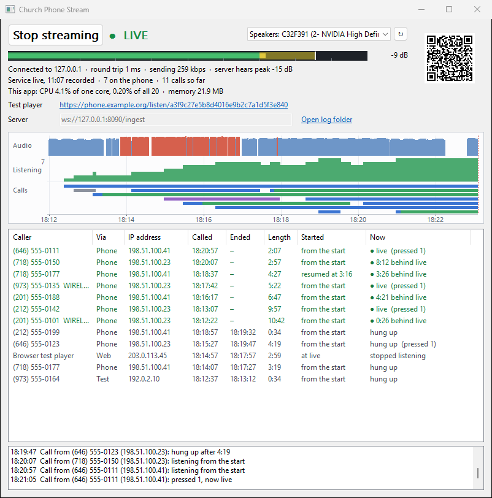

# Church Phone Stream

Lets people listen to a church service by calling an ordinary phone number.
A small Windows app sends what the church PC plays to your server, which
plays it to callers through [Plivo](https://www.plivo.com/). Made for members
without internet or a smartphone.

- **Any phone:** callers dial a normal number; nothing to install.
- **Listen your way:** new callers start at the beginning, returning callers
  resume, pressing **1** jumps to live. The recording plays after the service.
- **One Windows .exe:** no installer, doesn't touch OBS, one outgoing
  connection on port 443, holds 10 minutes of audio through internet drops.
- **See who's listening:** the call list and a timeline of audio level,
  listeners and calls.
- **Light server:** Node.js with no npm packages; a one-CPU VM handles 100
  callers.

*A demo service with made-up callers.*

## How it works, performance and cost

![How it works, with performance and cost: PhoneStream.exe on the church PC (4% of one CPU core, 22 MB) sends just one stream, however many people call, over TLS on port 443 (16 kHz, 260 kbps, 14 ms round trip) to your internet server, a Linux VM with Apache then Node.js, which records the service and keeps each caller's place. On one CPU core with 10, 50 and 100 callers the server used 4.8%, 8.3% and 11.6% CPU and 61, 64 and 70 MB, sent 0.9, 4.6 and 9.3 Mbps, with about 120 ms delay to callers and no pauses. It sends one stream per call, 8 kHz mu-law at 93 kbps, to Plivo, which keeps 1 s queued as a cushion. With four 90-minute services a month, Plivo costs $20.30, $99.50 and $198.50 a month for 10, 50 and 100 callers on a local number, or $65.80, $325 and $649 on a toll-free number. Live callers hear the service about 1.2 s after the room plus the phone network's delay.](docs/flow-and-cost.svg)

On a real one-vCPU VM behind Apache, 100 pretend calls over the internet also
played with no pauses, and at 50 callers the whole VM used about 10% CPU.
Plivo's costs are from its [US price list](https://www.plivo.com/voice/pricing/us/)
(November 2026), which includes audio streaming; check it before budgeting.

## Getting started

1. Build the app (Visual Studio 2022 Build Tools):
   `app\build.ps1 -Server wss://phone.example.org/ingest`. See [app/README.md](app/README.md).
2. Install the server on a Linux VM with TLS: run `make-vm-install.ps1` and
   paste its output into the VM. See [server/README.md](server/README.md).
3. In Plivo, set a number's Answer URL (POST) to the one the install prints.
4. Run `PhoneStream.exe` at church and press **Start streaming**.

The key the app and server share is built into your `.exe` and
`vm-install.sh`: keep both private.

Tested with pretend calls and load tests; not yet with real Plivo calls.

## License

[MIT](LICENSE)
